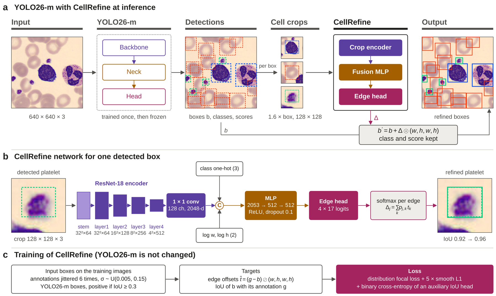

# CellRefine: Crop-Based Bounding Box Refinement for YOLO Detection of Peripheral Blood Cells

Code, results, and refiner weights for the manuscript *"CellRefine: Crop-Based Bounding Box Refinement for YOLO Detection of
Peripheral Blood Cells"* (Mustafa Yurdakul, Kırıkkale University; under review). The work was supported by TÜBİTAK under the
1002-A program (project 126E581).

The study has two parts:

1. **Benchmark.** 45 real-time detectors (43 YOLO models from YOLOv3 to YOLO26 and two RT-DETR models) were trained on the
   released partition of the TXL-PBC dataset with identical settings and three seeds each (Ultralytics 8.4.191).
2. **CellRefine.** A second stage is attached to the trained YOLO26-m. Each detected cell is cropped from the original image at
   1.6 times its box size and resampled to 128 × 128 px. A ResNet-18 network then predicts corrections to the four box edges
   as discrete distributions. The detector is not changed, and classes and scores are kept.



## Main results (TXL-PBC test set, mean ± SD over three runs)

| Model | Params (M) | mAP50 (%) | mAP75 (%) | mAP50–95 (%) | Platelet AP50–95 (%) |
|---|---|---|---|---|---|
| YOLO26-m | 21.8 | 99.02 ± 0.10 | 97.08 ± 0.29 | 87.80 ± 0.23 | 83.45 ± 0.52 |
| YOLO26-m + CellRefine | 34.4 | 99.02 ± 0.10 | 97.41 ± 0.07 | 88.31 ± 0.33 | 84.22 ± 0.62 |
| YOLO12-s | 9.3 | 98.92 ± 0.09 | 96.96 ± 0.38 | 87.76 ± 0.08 | 83.39 ± 0.52 |
| YOLO12-s + CellRefine-L | 13.4 | 98.92 ± 0.09 | 97.25 ± 0.13 | 88.35 ± 0.08 | 84.52 ± 0.59 |

- **Benchmark:** the best five detectors by mAP50–95 were YOLO26-m (87.79 ± 0.24), YOLO12-s (87.76 ± 0.07), YOLO26-s
  (87.48 ± 0.60), YOLO12-l (87.47 ± 0.18), and YOLO26-l (87.47 ± 0.46). All 45 models are listed in
  `results/benchmark/summary_test.csv`.
- **Transfer to other detectors:** the refiner of YOLO26-m run 0 improved 11 other detectors without retraining. The gains
  over all 12 detectors were 0.32–0.82 points (Wilcoxon signed-rank test, p < 0.001); see
  `TXLPBC_runs/cellrefine/metrics/r18_s0_on_*.json`.

## Repository layout

```
download_weights.py        downloads the three refiner weights from release v1.0
benchmark/                 training of the 45 detectors (seed 0, seeds 1-2, RT-DETR)
cellrefine/                CellRefine: model, training, evaluation, oracle, box voting, run scripts
analysis/                  metric re-implementation (evalcore.py), reproduction, per-detection and activation-map analyses
figures/scripts/           scripts of all manuscript figures; figures/png previews; figures/drawio editable diagrams
results/benchmark/         summary tables of the 45 detectors (mean, SD, min, max per metric) and all 135 runs
results/analysis/          per-detection IoU changes, AP per IoU threshold, activation-map statistics, numbers used in the text
results/dataset/           image and box statistics of TXL-PBC
TXLPBC_runs/               raw outputs in the original layout used by the code:
  train/, seeds/train/       training curves (results.csv) and settings (args.yaml) of every run
  metrics/, metrics_seeds/   validation and test metrics of every run (JSON)
  eval_test/, eval_val/      evaluation outputs
  cellrefine/metrics/        CellRefine evaluation results (validation grid, chosen settings, test metrics)
  cellrefine/runs/           refiner settings and training histories (args.json, hist.json); the weights are downloaded
                             into r18_s{0,1,2}/best.pt (see Weights)
  cellrefine/preds/          cached detector predictions (train, val, test) used to train and evaluate the refiners
```

## Weights

The refiner weights are not stored in the git tree. Download them from the links below (release
[v1.0](https://github.com/ymyurdakul/TXL-PBC-CellRefine/releases/tag/v1.0)).

| Refiner | Detector | Test mAP50–95 with refinement | Download | Place at |
|---|---|---|---|---|
| CellRefine, run 0 | YOLO26-m run 0 | 88.68 | [Download from link](https://github.com/ymyurdakul/TXL-PBC-CellRefine/releases/download/v1.0/cellrefine_r18_s0.pt) | `TXLPBC_runs/cellrefine/runs/r18_s0/best.pt` |
| CellRefine, run 1 | YOLO26-m run 1 | 88.02 | [Download from link](https://github.com/ymyurdakul/TXL-PBC-CellRefine/releases/download/v1.0/cellrefine_r18_s1.pt) | `TXLPBC_runs/cellrefine/runs/r18_s1/best.pt` |
| CellRefine, run 2 | YOLO26-m run 2 | 88.25 | [Download from link](https://github.com/ymyurdakul/TXL-PBC-CellRefine/releases/download/v1.0/cellrefine_r18_s2.pt) | `TXLPBC_runs/cellrefine/runs/r18_s2/best.pt` |

All three files can also be downloaded and placed in one step, with their checksums verified:

```bash
python download_weights.py
```

- **Format:** each file holds the refiner state dict (`model`), the training arguments (`args`), the selected epoch, and the
  validation scores (float32, about 48 MB).
- **Run 0:** this refiner was trained with an earlier version of `cellrefine/train_refine.py`, so its `args` have no `geo`
  entry.
- **Not included:** the YOLO detector weights and the CellRefine-L weights are not part of this repository. The cached
  detector predictions in `TXLPBC_runs/cellrefine/preds` are enough to reproduce and retrain the refiners without them.

## Setup

```bash
pip install -r requirements.txt
```

Download TXL-PBC (Gan et al., Scientific Data 12, 1694, 2025, https://doi.org/10.1038/s41597-025-05980-z) and place it so
that the images and labels are at `TXL-PBC_Dataset-master/TXL-PBC/{images,labels}/{train,val,test}`. The scripts use the
repository root as their base directory; set `TXLPBC_ROOT` to use another location.

## Reproducing the results

Run all commands from the repository root. Download the weights first (see Weights).

```bash
# CellRefine on YOLO26-m from the cached predictions and the released weights (CPU or GPU, about 1 min per run on CPU)
python analysis/reproduce_cellrefine.py
# AP at each IoU threshold and the per-detection analysis
python analysis/ap_per_threshold.py
python analysis/improve_analysis.py
# activation maps (HiResCAM) of the edge offsets
python analysis/gradcam/gc_stats.py
python analysis/gradcam/gc_mean.py
```

The reproduction gives 88.68, 88.02, and 88.25 for the three runs, as reported. The mean, 88.315, lies on a rounding boundary.
The manuscript values were computed on a GPU with mixed precision and print as 88.31, while the CPU run can print 88.32.

Training (GPU required):

```bash
python benchmark/train_all_yolo.py            # 43 YOLO models, seed 0
python benchmark/seeds_all.py 1 2             # seeds 1 and 2
python benchmark/train_rtdetr.py              # RT-DETR-l and RT-DETR-x
python cellrefine/train_refine.py --det yolo26m_s0 --name r18_s0 --seed 0
python cellrefine/eval_refine.py --det yolo26m_s0 --run r18_s0 --iters 1,2 --betas 0 --lams 0.5,0.75,1.0 --tag _lam
bash cellrefine/run_main.sh                    # all three runs
```

Figures are produced by the scripts in `figures/scripts` (for example, `python figures/scripts/fig9_improvement.py`). Their
output is written to `figures/output`.

## Notes

- **Metrics:** `analysis/evalcore.py` re-implements the detection metrics of Ultralytics 8.4.191 (greedy matching over IoU
  0.50:0.95, 101-point AP) and reproduces its mAP50–95 values.
- **Excluded experiments:** experiments that modified the detector itself are not part of the manuscript and are not included.

## Citation

The manuscript is under review; the citation will be added after publication.

## License

The code is released under the MIT License (see `LICENSE`). The TXL-PBC images and annotations are not included and remain
subject to the terms of their authors.
